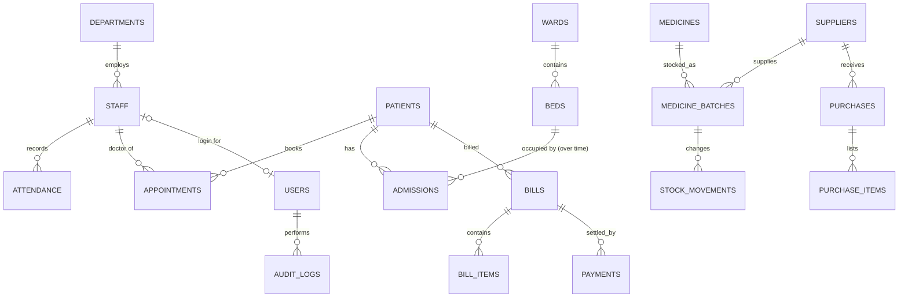

# 🏥 MediTrack: Hospital Management and Resource Tracking System

A college-level hospital management application built with **Python, Streamlit and SQLite**.
It covers patients, doctors and staff, attendance, appointments, wards/beds and admissions,
pharmacy batches and stock movements, suppliers and purchases, billing and payments,
dashboards, reports with safe exports, user accounts with role-based permissions, an
append-only audit log, and backup/restore.

**Live demo:** https://solar-lamp.github.io/Hospital-Management/

> Educational prototype — **not** a clinically certified system. All data is fictional.
> Do not enter real patient information.

## How the GitHub Pages hosting works

GitHub Pages can only serve static files, so the hosted version runs the *same Python code*
inside the browser using [stlite](https://github.com/whitphx/stlite) (Streamlit on
Pyodide/WebAssembly):

* `scripts/build_site.py` copies the Python sources into `_site/` with an `index.html`
  that boots stlite.
* The SQLite database file lives in the browser's **IndexedDB**, so each visitor gets a
  private copy of the demo data that survives page reloads. Nothing is sent to a server.
* On first visit the browser downloads Python (~30 MB) and creates fictional demo data;
  allow up to a minute. Later visits are faster.
* `.github/workflows/pages.yml` builds the site, runs a headless-browser smoke test
  (logs in, opens every module, registers a patient, reloads and checks it persisted),
  and deploys from the default branch.

**One-time setup:** in the repository go to **Settings → Pages → Build and deployment →
Source** and choose **GitHub Actions**. Then re-run the "Deploy to GitHub Pages" workflow
(Actions tab → workflow → *Run workflow*).

### Demo accounts (fictional)

| Role | Username | Password |
|---|---|---|
| Administrator | `admin` | `Admin@123` |
| Receptionist | `reception` | `Reception@123` |
| Pharmacist | `pharmacist` | `Pharma@123` |
| Billing staff | `billing` | `Billing@123` |
| Doctor | `doctor` | `Doctor@123` |
| Nurse | `nurse` | `Nurse@123` |

Each role sees only the modules it is allowed to use. *Settings → Reset demo data*
rebuilds the demo database in your browser.

## Running locally

Requires Python 3.13 (3.11+ should work).

```bash
python -m venv .venv
source .venv/bin/activate          # Windows: .venv\Scripts\activate
pip install -r requirements.txt
python seed.py                     # optional: fictional demo data + demo accounts
streamlit run app.py               # opens http://localhost:8501
```

Without `seed.py`, the first start asks you to create an administrator account (or load
demo data). The database is stored in `data/hospital.db` (git-ignored). `python seed.py
--reset` recreates the demo database. Optional settings are listed in `.env.example`.

Run the tests with `python -m pytest -q`. Preview the static build with
`python scripts/build_site.py && python -m http.server -d _site 8000`.

## Features

| Module | What is implemented |
|---|---|
| Dashboard | Live metrics (patients, staff, today's appointments, admissions, beds, stock, alerts, billed/collected/outstanding) and charts: appointments by day and status, bed occupancy by ward, admissions vs discharges, billed vs collected by month, stock by category. Empty-database safe. |
| Patients | Register with auto code `PAT-000001`, validation, duplicate warning, search by code/name/phone, registration-date filter, edit, archive/reactivate (no hard delete), appointment/admission/bill history. |
| Doctors & staff | Staff directory with role/department/status filters, add/edit, departments table, daily attendance (present/absent/leave/half-day, one record per staff per day). |
| Appointments | Booking with doctor overlap check (cancelled/no-show free the slot), daily list, search, status workflow, rescheduling. Doctors see and update only their own appointments. |
| Admissions & beds | Ward/bed setup, live bed board, admit (bed must be operational and free), discharge with optional bed-charge bill in the same transaction, cancel admission recorded in error. |
| Pharmacy | Medicine catalogue, batches with expiry, receipts, FEFO issue, issue from batch, returns, adjustments, low-stock/near-expiry/expired alerts, full movement history and reconciliation check. |
| Suppliers & purchases | Supplier records, purchase receipt history with costs. |
| Billing & payments | Multi-line bills (discount, tax), links to admission/appointment, partial payments, overpayment blocked, void payment / void bill workflows. |
| Reports | 14 filtered reports (patients, appointments, attendance, admissions, occupancy, stock, expiry, movements, purchases, bills, payments, monthly summary) with column selection and CSV/Excel export. |
| Users & security | PBKDF2-SHA256 password hashing, login/logout, idle timeout, account deactivation, role permissions checked in services, append-only audit log, backup/restore. |

## Architecture

```text
Browser ──► Streamlit pages (pages/*.py, app.py)      forms, tables, charts, navigation
               │
               ▼
            Services (services/*.py)                   validation, permissions, workflow
               │                                       rules, transactions, audit
               ▼
            Repositories (repositories/*.py)           parameterized SQL only
               │
               ▼
            SQLite (database.py)                       schema, constraints, migrations,
                                                       backups
```

* `app.py` — page config, database bootstrap, login gate and role-aware `st.navigation`.
* `database.py` — connections (`PRAGMA foreign_keys = ON`), `transaction()` using
  `BEGIN IMMEDIATE` with rollback on any error, versioned migrations, backup/restore
  via SQLite's online backup API.
* `utils/permissions.py` — the single role → permission map. Every protected service
  function calls `require(user, permission)`; hidden menus are not the only safeguard.
* `utils/validators.py`, `utils/formatting.py`, `utils/export_utils.py`, `utils/ui.py`.

### Database

18 tables: `departments, staff, attendance, users, patients, appointments, wards, beds,
admissions, suppliers, medicines, medicine_batches, stock_movements, purchases,
purchase_items, bills, bill_items, payments, audit_logs` (+ `schema_migrations`).



Key integrity rules enforced by the database itself (and checked again in services):

* Partial unique indexes: one active admission per bed and per patient.
* `quantity_on_hand >= 0`; guarded `UPDATE ... WHERE quantity_on_hand + ? >= 0`.
* `bill_items.line_total = quantity × unit_price`; `bills.total = subtotal − discount + tax`.
* Appointment `end_at > start_at`; one attendance row per staff per day.
* Triggers make `audit_logs` append-only.

**Conventions:** money is stored as integer paise (`*_minor` columns) and converted with
`Decimal`; dates are `YYYY-MM-DD`; timestamps are local time `YYYY-MM-DD HH:MM:SS`.

### Metric definitions

| Metric | Definition |
|---|---|
| Registered patients | All patient records (active and archived; breakdown in tooltip) |
| Active staff | Staff with status `ACTIVE` |
| Appointments today | Starting today with status scheduled, confirmed or completed |
| Current admissions | Admissions with status `ADMITTED` |
| Occupied / available beds | Beds with an active admission / operational beds without one |
| Medicines in stock | Medicines with at least one non-expired batch with quantity > 0 |
| Low stock | Active medicine whose usable (non-expired) stock is **≤** its reorder level |
| Expiring batches | Batches with stock expiring from **today (inclusive)** to today + 90 days |
| Billed / collected this month | `FINAL` bills dated / `ACCEPTED` payments made this calendar month |
| Outstanding balance | `FINAL` bill totals − their accepted payments |

## Testing

`tests/` contains 82 automated tests (pytest + Streamlit `AppTest`) using a temporary
database per test, so demo data is never modified. They cover the plan's test cases:

| Plan ID | Test |
|---|---|
| T01–T03, T15 | `test_patients.py` — register, blank name, search, no-match / wildcard escaping |
| T04–T05 | `test_appointments.py` — end before start, overlap, cancelled frees slot |
| T06–T08 | `test_beds.py` — admit, occupied bed rejected (service and DB index), discharge releases bed |
| T09–T12 | `test_pharmacy.py` — receipt, issue, over-issue, expired issue, FEFO, reconciliation |
| T13–T14 | `test_billing.py` — totals, rounding, payments, overpayment, voids, atomic save |
| T16, T18–T20 | `test_reports_and_system.py` — empty dashboard, persistence, backup/restore, filtered export with formula-injection guard |
| T17 | `test_auth_permissions.py` — unauthorized operations per role, hashing, deactivation |
| UI | `test_ui.py` — every page renders for every role; direct navigation outside a role is refused |

CI runs the tests on every push (`.github/workflows/tests.yml`) and a real-browser smoke
test of the hosted build (`.github/workflows/pages.yml`).

## Known limitations

* Single-instance SQLite prototype; a multi-user production deployment would need a
  server database (e.g. PostgreSQL), HTTPS hosting, and a security/privacy review.
* The GitHub Pages demo stores data only in the visitor's browser; clearing site data
  removes it. Use *Settings → Download database backup* to keep a copy.
* Password hashing uses PBKDF2-SHA256 from Python's standard library (so it also works
  in WebAssembly) rather than Argon2/bcrypt.
* No refunds/overpayments, no prescriptions or clinical decision support, no
  multi-shift attendance, and no email/SMS integrations.
